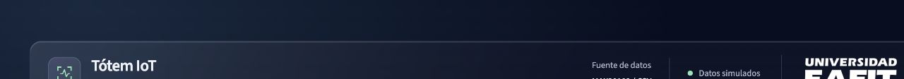

# Tótem IoT: proyecto integrador EAFIT

Dashboard en Python, Streamlit, Pandas y Plotly para explorar las mediciones simuladas del sensor MAX30102. Incluye filtros por fecha, estudiante y estado, seguimiento individual, nueve gráficos y exportación CSV. Los registros se agrupan por fecha y hora de Bogotá.

El CSV original está incluido y no se modifica al filtrar o analizar. Los datos son simulados y la aplicación no tiene uso diagnóstico.



## Indicadores y hallazgos

| Indicador | Archivo completo, sin filtros |
| --- | ---: |
| Mediciones | 2.667 |
| Estudiantes distintos | 295 |
| Mediciones válidas | 97,11% (2.590 filas) |
| BPM promedio, sólo válidas | 75,47 bpm |
| SpO₂ promedio, sólo válidas | 97,72% |

Tres hallazgos verificables del archivo completo:

1. Hay 77 mediciones inválidas, aunque todas contienen valores numéricos. Se conservan para analizar calidad y se excluyen de los promedios del sensor.
2. Excluyendo las dos fechas extremas, hay 121,15 registros diarios de lunes a viernes frente a 16,50 los fines de semana.
3. Al convertir UTC a Bogotá, 385 registros cambian de fecha. Los filtros y agrupamientos diarios usan la fecha local.

El [informe reproducible](analisis/informe.md) documenta las reglas, los valores atípicos, un cuarto hallazgo y las tablas que respaldan las conclusiones.

## Ejecutar

Usar Python 3.12, la misma versión prevista para Streamlit Community Cloud.

Validación local: diez pruebas aprobadas con Python 3.12.14 y las dependencias fijadas en `requirements.txt`.

```bash
python -m venv .venv
source .venv/bin/activate
python -m pip install -r requirements.txt
streamlit run app.py
```

En Windows, la activación es `.venv\Scripts\activate`.

Para regenerar el informe y los agregados:

```bash
python analizar.py
python -m unittest discover -s tests -v
```

## Contenido

- `app.py`: cinco KPI, nueve gráficos, filtros por fecha, estudiante y estado, seguimiento individual y descarga de los registros seleccionados.
- `ui.py` y `theme.css`: presentación visual inspirada en la captura suministrada por el usuario.
- `datos.py`: lectura, validación de estructura, conversión horaria y cálculos compartidos.
- `analizar.py`: exploración reproducible del archivo completo.
- `analisis/informe.md`: dimensiones, tipos, nulos, duplicados, estados, indicadores, atípicos y cuatro hallazgos verificables.
- `analisis/resumen.json`: resultados exactos y huella SHA-256 del CSV.
- `analisis/*.csv`: tablas que respaldan los hallazgos.
- `tests/`: pruebas de indicadores, fechas y comportamiento del dashboard.
- `PUBLICAR.md`: configuración de GitHub y Streamlit Cloud y comprobaciones del enlace publicado.

## Reglas del análisis

Los filtros de fecha usan `America/Bogota` y ambos extremos son inclusivos. Los conteos incluyen todos los estados seleccionados. Los promedios de BPM y SpO₂ sólo incluyen filas cuyo estado original es `valid`; no se imputan nulos. Seleccionar sólo `invalid` deja esos promedios sin datos. Una selección vacía se indica explícitamente.

La marca `valid` procede del archivo, no de un umbral inventado. Los valores atípicos estadísticos se conservan y no son diagnósticos. Los gráficos individuales muestran la hora local de Bogotá, independientemente de la zona del navegador.

Los cinco KPI implementados son mediciones, estudiantes únicos, porcentaje válido, BPM promedio y SpO₂ promedio. Antes de la entrega debe cotejarse esta selección con el listado exacto de la rúbrica.

## Publicación

Repositorio: [Fhasivia/eafit-iot-dashboard](https://github.com/Fhasivia/eafit-iot-dashboard), rama `main`. La aplicación está preparada para Streamlit Community Cloud; el despliegue del enlace público está pendiente. Los pasos y casos de validación están en [PUBLICAR.md](PUBLICAR.md).

1. Usar este repositorio y conservar el CSV y `.streamlit/config.toml`. No subir `.venv` ni credenciales.
2. En Streamlit Community Cloud, conectar la cuenta de GitHub y elegir el repositorio, la rama y `app.py` como archivo principal.
3. Elegir Python 3.12 en las opciones avanzadas y desplegar.
4. Comprobar los cinco indicadores sin filtros, fechas extremas, estudiante individual, estado `invalid`, selección vacía y descarga CSV en la aplicación publicada.

Si se sube la carpeta `eafit-iot` dentro de otro repositorio, el archivo principal será `eafit-iot/app.py`; es preferible que esta carpeta sea la raíz del repositorio.

Referencia: [despliegue en Streamlit Community Cloud](https://docs.streamlit.io/deploy/streamlit-community-cloud/deploy-your-app/deploy), [dependencias](https://docs.streamlit.io/deploy/streamlit-community-cloud/deploy-your-app/app-dependencies) y [conversión de zona horaria en Pandas](https://pandas.pydata.org/docs/reference/api/pandas.Series.dt.tz_convert.html).

Quedan para la entrega final: contrastar la rúbrica completa, completar los datos del equipo, publicar en Streamlit Cloud, y preparar y grabar el video de 5 a 8 minutos.

## Decisiones de interfaz

La versión visual actual sigue la referencia oscura facilitada por el usuario: fondo azul noche, superficies translúcidas, tarjeta de validez con borde luminoso y acentos verde menta y violeta. Las decisiones se detallan en `DESIGN.md`.

Los filtros están en una barra superior. Cuatro KPI aparecen a la izquierda, el porcentaje válido ocupa la tarjeta central y los tres últimos registros filtrados se muestran a la derecha. El gráfico diario, los hallazgos y una vista previa de cinco filas permiten verificar el período seleccionado. Ambas descargas exportan todas las filas filtradas, no sólo la vista previa.

Las tres pestañas y los nueve gráficos mantienen las preguntas de actividad, seguimiento individual y calidad. El tema predeterminado es oscuro, como en la referencia. El estilo de paneles está diseñado para ese tema; no se incluye un segundo diseño claro personalizado.

Revisión del rediseño y evidencia de pruebas: `anti-slop/audit-001-2026-11-05.md`. Captura: `analisis/dashboard-nocturno.jpg`.

La cabecera actual incorpora el logo blanco oficial de EAFIT a la derecha y centra verticalmente sus bloques. El logo está incluido en `assets/` con su fuente documentada. Captura actual: `analisis/dashboard-eafit.jpg`; detalle: `analisis/cabecera-eafit.jpg`. Verificación del ajuste: `anti-slop/audit-002-2026-11-05.md`.
